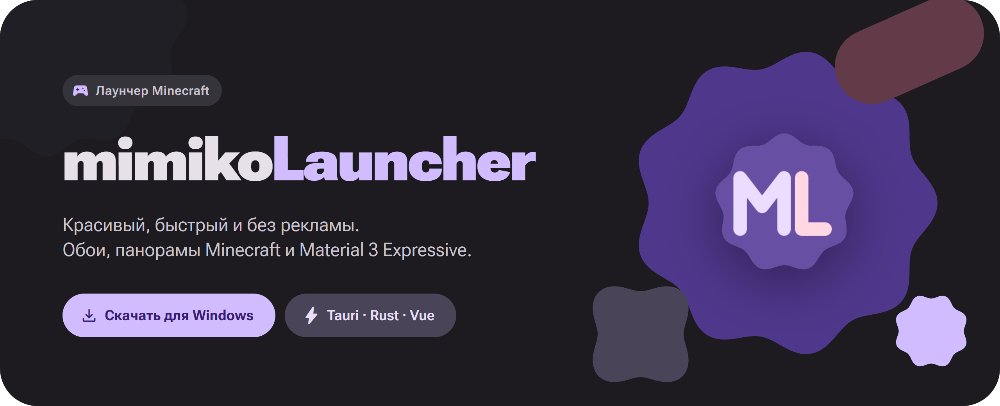
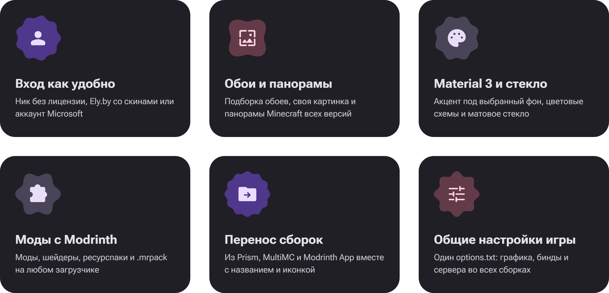
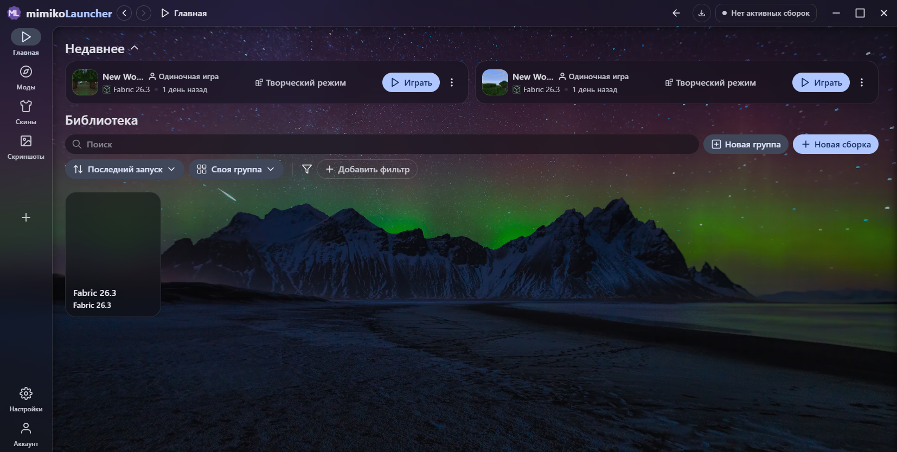
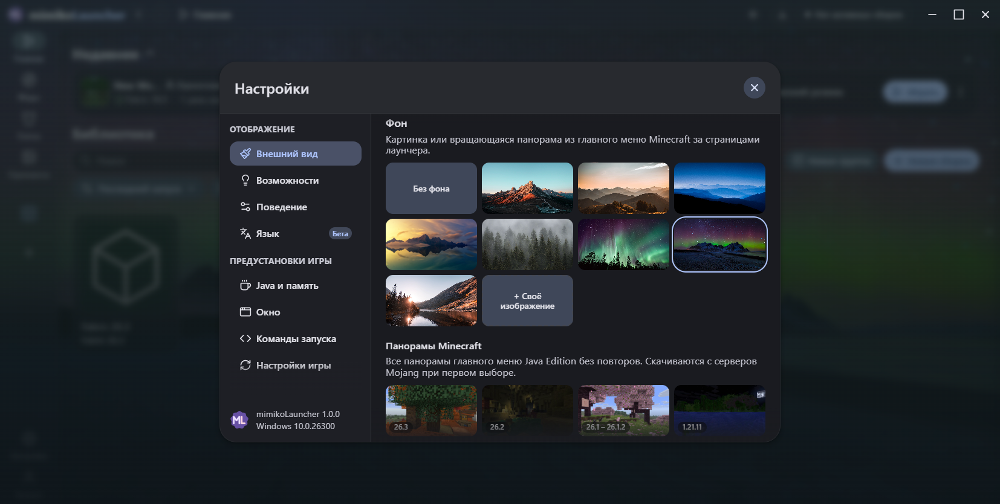
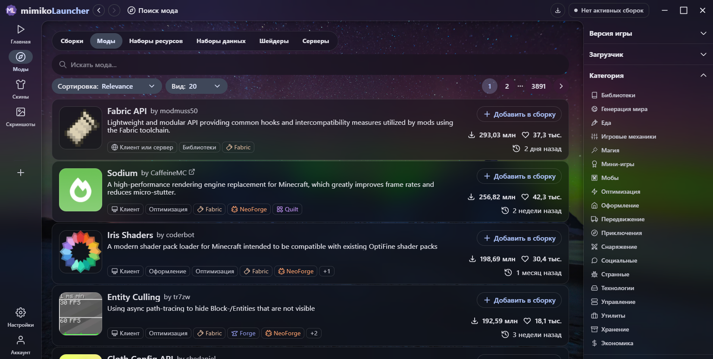
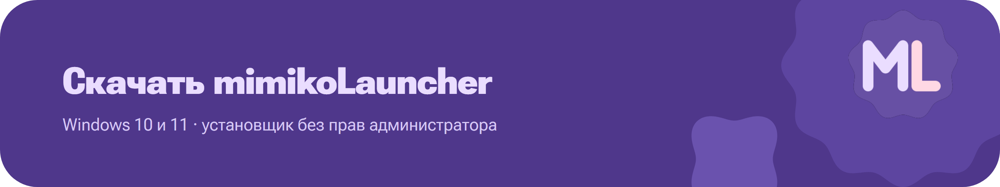

<div align="center">

<a href="https://github.com/krinix1337/mimikoLauncher/releases/latest">
	
</a>

<br />
<br />

[](https://github.com/krinix1337/mimikoLauncher/releases/latest) [](https://github.com/krinix1337/mimikoLauncher/releases/latest) [](https://tauri.app) [](https://www.rust-lang.org) [](https://vuejs.org) [](apps/app/LICENSE)

**[Скачать](https://github.com/krinix1337/mimikoLauncher/releases/latest)** &nbsp;·&nbsp; **[Возможности](#-возможности)** &nbsp;·&nbsp; **[Скриншоты](#-скриншоты)** &nbsp;·&nbsp; **[Установка](#-установка)** &nbsp;·&nbsp; **[mimiko.fun](https://mimiko.fun)**

</div>

<br />

## ✨ Возможности



<details>
<summary><b>Подробнее о каждой возможности</b></summary>
<br />

| | Что умеет |
| :-- | :-- |
| 🎮 **Вход** | По нику без лицензии (UUID совпадает с офлайн-режимом сервера), через [Ely.by](https://ely.by) со скинами в игре или через аккаунт Microsoft |
| 🖼️ **Фон** | Восемь обоев в высоком качестве, своя картинка с компьютера и панорамы главного меню Minecraft — от Classic до 26.x, плюс первоапрельские. Панорама медленно вращается, как в игре |
| 🎨 **Оформление** | Material 3 Expressive, цветовые схемы, акцент под выбранные обои и матовое стекло рамки с настраиваемым размытием |
| 📦 **Контент** | Моды, шейдеры, ресурспаки и модпаки `.mrpack` с Modrinth. Fabric, Quilt, Forge и NeoForge |
| 📂 **Перенос** | Сборки из Prism Launcher, MultiMC и Modrinth App — достаточно выбрать папку, название и иконка сохранятся |
| ⚙️ **Настройки игры** | Загрузи готовый `options.txt` — графика, бинды и сервера будут одинаковыми во всех сборках |
| 🚫 **Без лишнего** | Никакой рекламы, баннеров и обязательного аккаунта |

</details>

## 📸 Скриншоты

<div align="center">



<sub><b>Главная</b> — недавние миры и библиотека сборок на обоях</sub>

<br />
<br />

<table>
<tr>
<td width="50%"></td>
<td width="50%"></td>
</tr>
<tr>
<td align="center"><sub><b>Внешний вид</b> — обои и панорамы Minecraft</sub></td>
<td align="center"><sub><b>Каталог</b> — моды с Modrinth</sub></td>
</tr>
</table>

</div>

## ⬇️ Установка

<a href="https://github.com/krinix1337/mimikoLauncher/releases/latest">
	
</a>

1. Открой [последний релиз](https://github.com/krinix1337/mimikoLauncher/releases/latest) и скачай `mimikoLauncher_x.x.x_x64-setup.exe`.
2. Запусти установщик — права администратора не нужны, лаунчер ставится для текущего пользователя.
3. Готово: ярлык появится на рабочем столе и в меню «Пуск».

> [!WARNING]
> Установщик пока не подписан сертификатом. Если Windows покажет «Windows защитила ваш компьютер», нажми **Подробнее → Выполнить в любом случае**.

> [!TIP]
> Уже есть сборки в Prism Launcher или Modrinth App? Нажми **＋ → Импорт** и выбери папку сборки — всё перенесётся вместе с названием и иконкой.

<details>
<summary><h2>🛠️ Сборка из исходников</h2></summary>

Нужны **Rust** (`rustup`), **Node.js 24+**, **pnpm** и на Windows — **Visual Studio Build Tools** (C++).

```bash
pnpm install
cp packages/app-lib/.env.prod packages/app-lib/.env
pnpm app:dev      # запуск в режиме разработки
pnpm app:build    # сборка установщика
```

> [!NOTE]
> Первая сборка Rust долгая. Чтобы компьютер не лагал, ограничь потоки: `CARGO_BUILD_JOBS=4`.

</details>

## 📄 Лицензия

mimikoLauncher основан на открытом [Modrinth App](https://github.com/modrinth/code) и распространяется по лицензии **GPL-3.0** — см. [`apps/app/LICENSE`](apps/app/LICENSE).

<sub>Название и логотип Modrinth — товарные знаки Rinth, Inc.; проект с ними не связан. Обои — с [Unsplash](https://unsplash.com), панорамы — из Minecraft © Mojang Studios.</sub>
